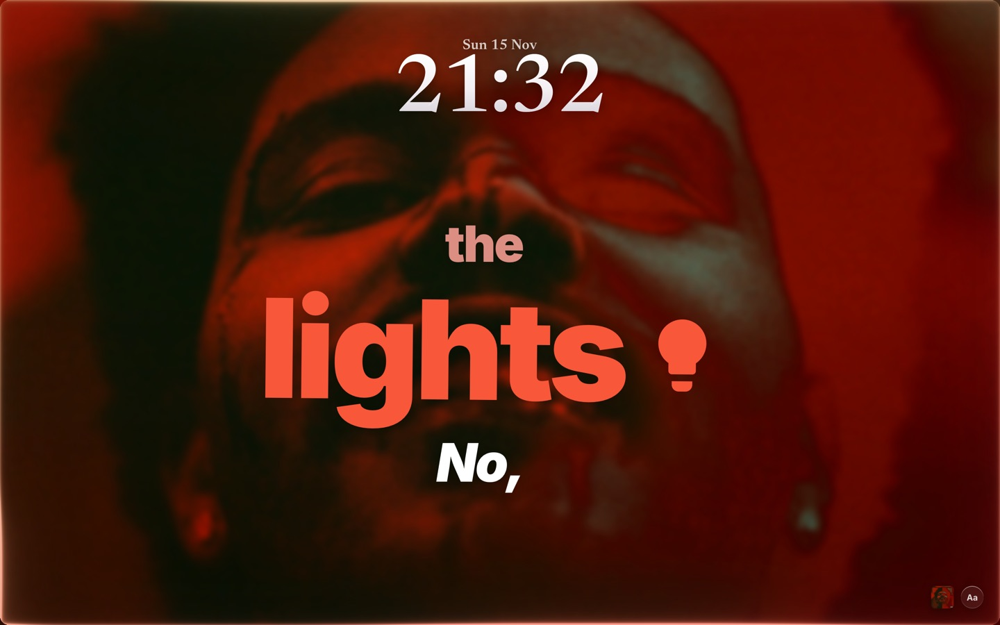
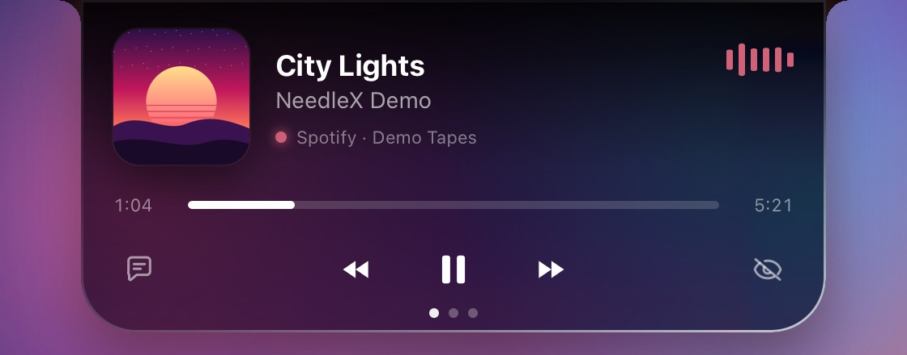
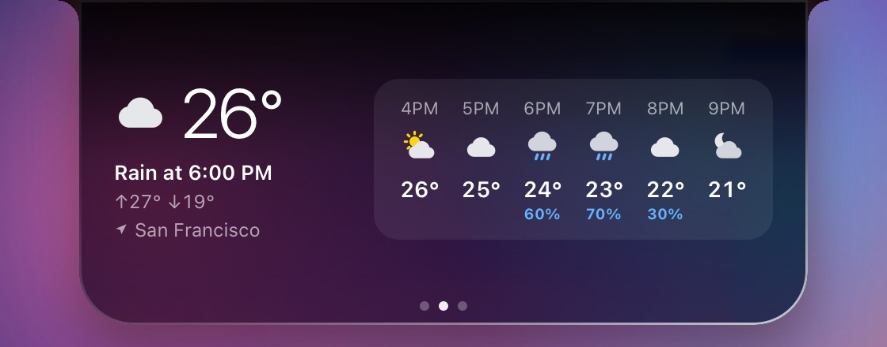
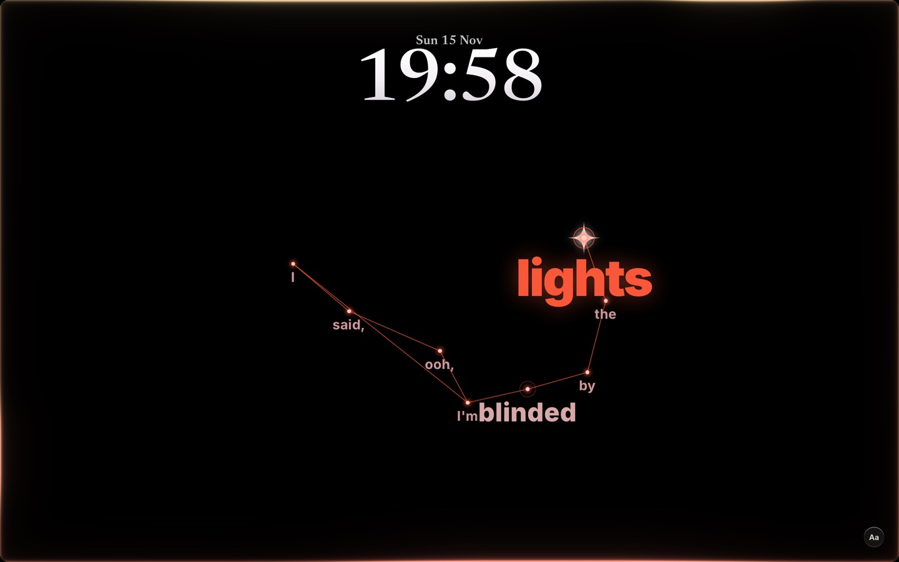
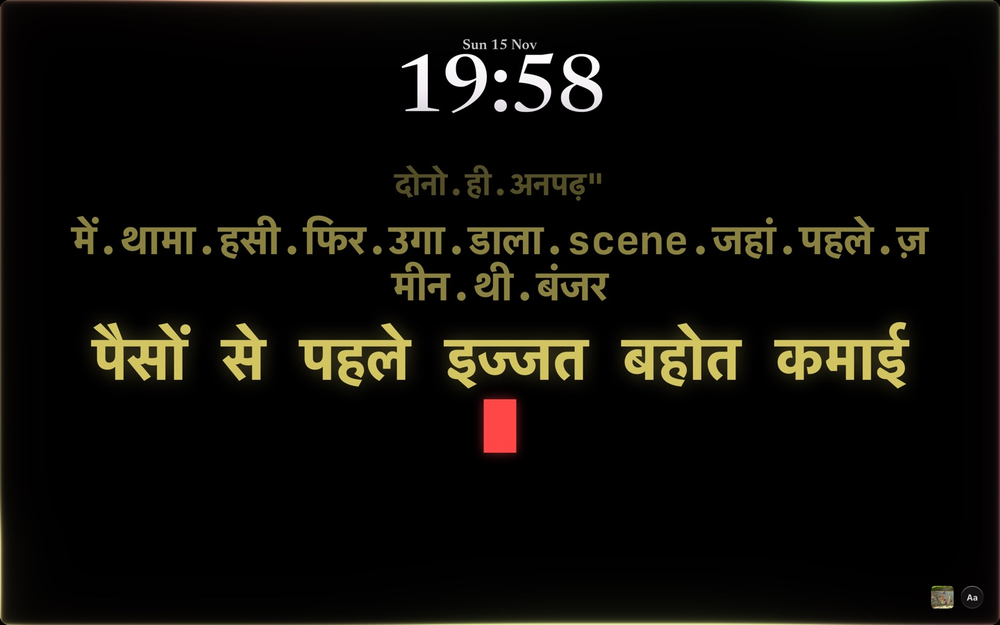
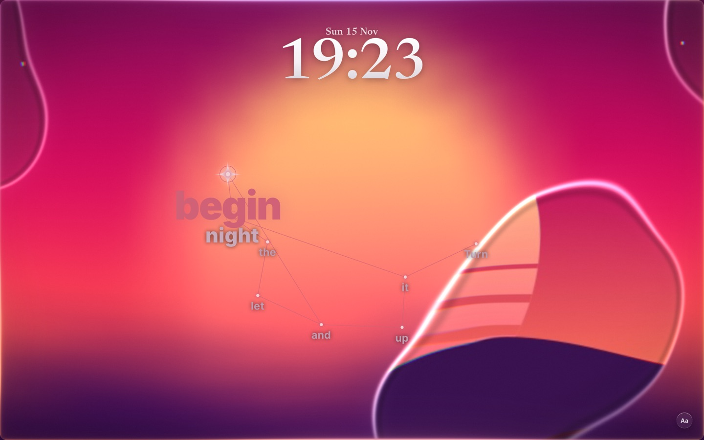
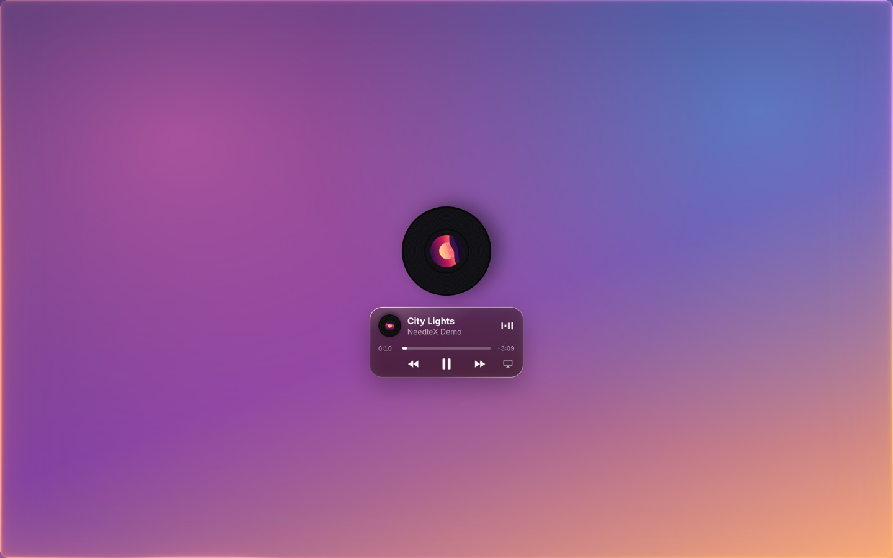
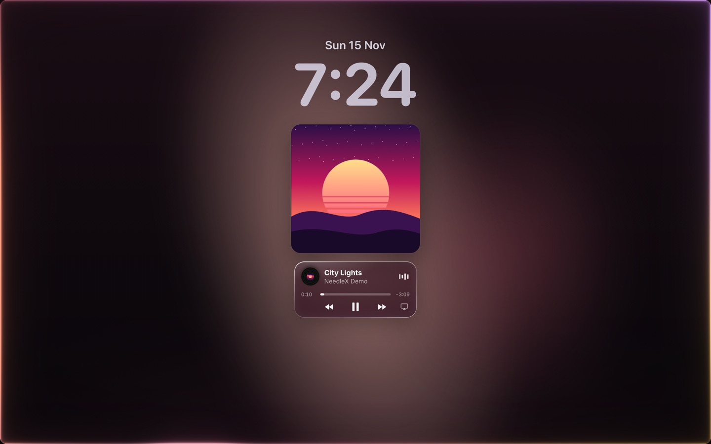
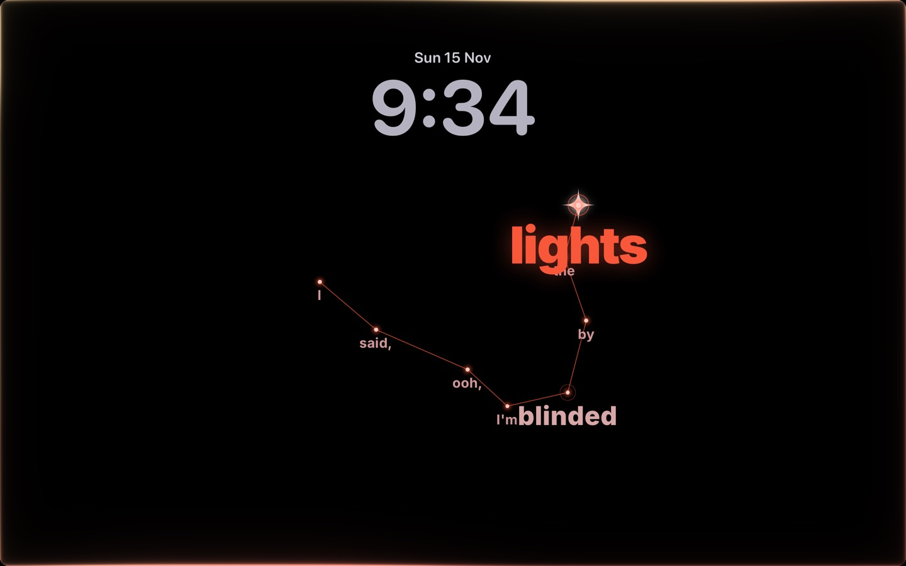

<!-- title: NeedleX 0.1.0 — First Spin -->
<p align="center">
  
</p>

**The first release of NeedleX for macOS.** NeedleX is a music island for the Mac notch. It follows
Spotify and Apple Music, turns the lyrics into animated effects on your desktop wallpaper, and puts
a record player on your lock screen.

One download works on **Apple silicon and Intel Macs** running **macOS 13 Ventura or later**.

## ⬇ Download

| File | What it is |
| --- | --- |
| **NeedleX-0.1.0.dmg** | Recommended. Open it and drag NeedleX into Applications |
| NeedleX-0.1.0.zip | The same app as a zip, for scripts or if you prefer zips |
| SHA256SUMS.txt | Checksums to verify the downloads (`shasum -a 256 -c SHA256SUMS.txt`) |

## 🚀 Install in a minute

1. Download **NeedleX-0.1.0.dmg**, open it and drag **NeedleX** into **Applications**.
2. Open NeedleX from Applications. NeedleX isn't notarized by Apple yet, so the first time macOS
   says it can't check it. Go to **System Settings → Privacy & Security**, scroll down, click
   **Open Anyway** next to NeedleX and confirm. You only do this once.
   Or run this in Terminal:
   ```bash
   xattr -dr com.apple.quarantine /Applications/NeedleX.app
   ```
3. NeedleX lives in the **menu bar** (it has no Dock icon). Play something in Spotify or Music and
   click **OK** when macOS asks if NeedleX may control it.
4. Explore the menu-bar icon: *Lyrics effect*, *Desktop wallpaper*, *Also on the lock screen*,
   *Beat glow* and more.

## ✨ What's in it

### 🎵 The island
A black island grows out of the notch while music plays. It shows the cover, title and a
visualizer driven by the real audio level. Point at it to open the player, which has scrubbing,
controls and synced lyrics. Swipe with two fingers for **Weather** and **Calendar**. You can pick
the notch or pill shape, turn on liquid glass, drag the island to move it, or hide it.

 

### 🔤 Six lyric effects × four backgrounds
**Big Words · Lens · Stars · Terminal · Aura · Scrolling lines.** The words take the cover's
colours. Each effect can use a **Simple**, **Glass**, **Liquid** or **Foggy** background, with the
album cover beside the lyrics if you like. Songs without synced lyrics still get an effect.

  

### 🖥 Desktop wallpaper
The lyrics play on your desktop, behind your windows and under your icons, on every Space. Your
own wallpaper comes back when the music stops. You can also choose a **turntable**, **record
sleeve** or **cover with aura** that sits on your wallpaper; drag it anywhere, or click it to
play or pause.

### 🔒 Lock screen
While music plays, a record turns under the clock, with a player card so you can play, pause and
skip without unlocking. Click it for the big cover, then again for the lyrics. NeedleX fades away
as soon as you start typing your password.

  

### 💡 And also
- **Beat glow:** a thin light around the screen edge that pulses in the cover's colours.
- **Full screen:** a cover and lyrics view (<kbd>Space</kbd> play / pause, <kbd>←</kbd>
  <kbd>→</kbd> skip, <kbd>Esc</kbd> leave). It can open by itself after a few idle minutes.
- **Hi-res covers:** looked up when a player only gives a small one.
- **Light on the battery:** animations pause when nothing moves and run at a capped frame rate.

## 🔐 Permissions and privacy
No account, no analytics, no tracking. macOS asks for each permission only when a feature needs it:

| Permission | For | Needed? |
| --- | --- | --- |
| Automation (Spotify / Music) | Song info and controls | Yes |
| System Audio Recording | Real visualizer and beat glow (only the loudness is measured) | Optional |
| Location | Weather page (rough location) | Optional |
| Calendars | Calendar page (events never leave your Mac) | Optional |
| Screen Recording | *Liquid glass* look only | Optional, off by default |

## ⚠️ Good to know
- **Not notarized yet**, so you approve it once on first launch (see *Install*).
- **Spotify and Apple Music only.** macOS has no public "now playing" interface for browsers and
  other players.
- The lock-screen view uses a private macOS framework. If a macOS update changes it, the lock
  screen simply stays as macOS draws it.
- Liquid glass needs macOS 14, and the real audio visualizer needs macOS 14.2.

## 📚 More
[README](https://github.com/n1h4r1k4/needlex-mac#readme) ·
[Changelog](https://github.com/n1h4r1k4/needlex-mac/blob/main/CHANGELOG.md) ·
[Report a bug](https://github.com/n1h4r1k4/needlex-mac/issues/new/choose) ·
[Contributing](https://github.com/n1h4r1k4/needlex-mac/blob/main/CONTRIBUTING.md)

<sub>Screenshots show *Blinding Lights* (The Weeknd) and *Nanchaku* (Seedhe Maut & MC Stan); covers and lyrics belong to their owners.</sub>
